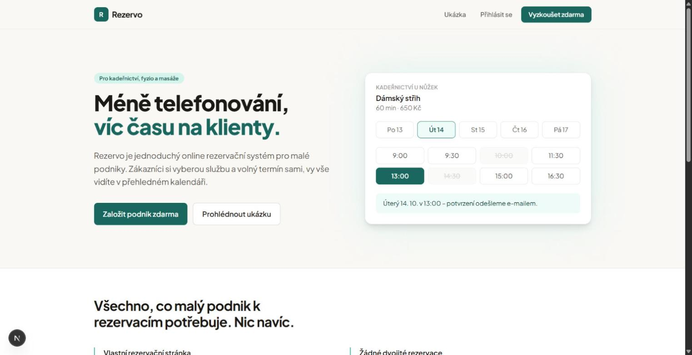
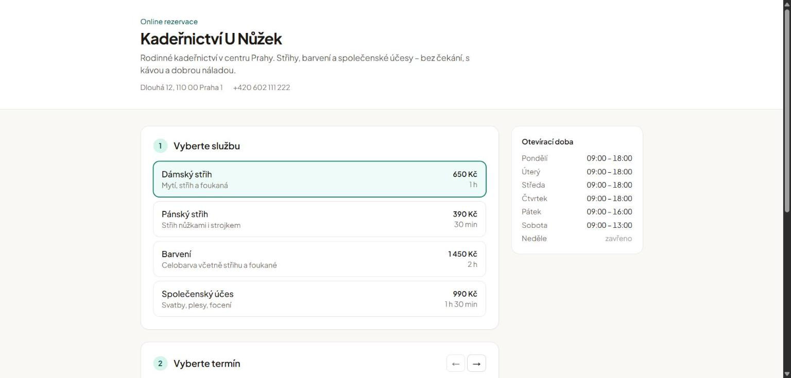
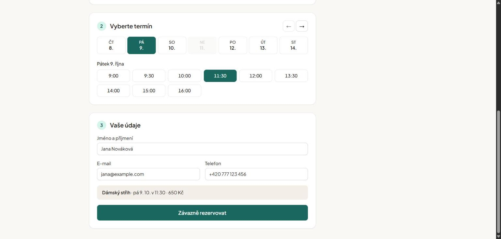
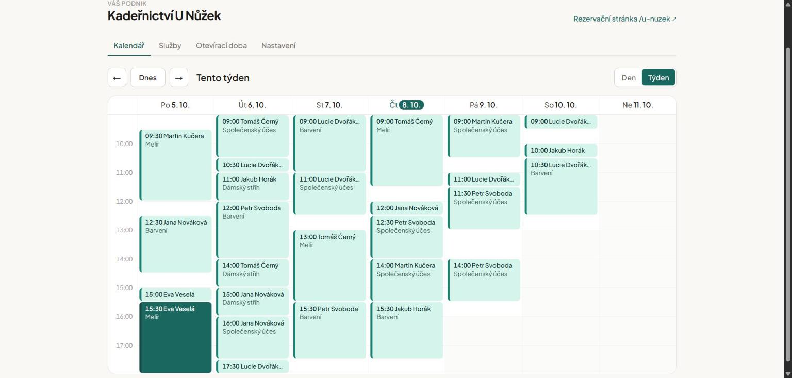

# Rezervo – online rezervace pro malé podniky

Rezervační systém pro kadeřnictví, fyzioterapie, masáže a podobné malé podniky. Majitel si nastaví služby a otevírací dobu, zákazníci si sami rezervují volný termín na veřejné stránce podniku a obě strany dostanou e-mail.

> Portfolio projekt · Next.js 16 (App Router) · TypeScript · Tailwind CSS 4 · Supabase · Resend · Cloudflare Workers

## Živé demo

**https://rezervo.bukac-adam.workers.dev**

| | |
| --- | --- |
| Veřejná rezervační stránka | [/u-nuzek](https://rezervo.bukac-adam.workers.dev/u-nuzek) – fiktivní „Kadeřnictví U Nůžek“ |
| Administrace majitele | [/login](https://rezervo.bukac-adam.workers.dev/login) – `demo@rezervo.test` / `demo-heslo-123` |
| API klíč demo podniku | po přihlášení v [/dashboard/api](https://rezervo.bukac-adam.workers.dev/dashboard/api) |
| REST API | `https://rezervo.bukac-adam.workers.dev/api/v1` – viz [Veřejné REST API](#veřejné-rest-api) |

```bash
curl -H "Authorization: Bearer <API klíč>" https://rezervo.bukac-adam.workers.dev/api/v1/services
```

<sub>Testovací účet je sdílený, nevyplňujte skutečné osobní údaje. V ukázkovém účtu nelze měnit heslo, adresu stránky, e-mail pro upozornění ani API klíč; tyto údaje se navíc každou hodinu obnovují (`/api/cron/demo-reset`). Data (služby, rezervace) obnoví `npm run seed`.</sub>



| Veřejná rezervační stránka | Výběr termínu a údaje zákazníka |
| --- | --- |
|  |  |



<sub>Screenshoty jsou z produkčního nasazení s ukázkovými daty.</sub>

## Funkce

- **Registrace a přihlášení majitele** (Supabase Auth, e-mail + heslo, potvrzení e-mailu).
- **Nastavení podniku** – název, adresa stránky (`/u-nuzek`), kontakty, služby (délka, cena), otevírací doba pro každý den v týdnu, krok nabízených časů.
- **Tým** – každý pracovník má vlastní kalendář a seznam služeb, které dělá. Ve stejný čas lze přijmout tolik rezervací, kolik je volných pracovníků. Zákazník si vybere konkrétního pracovníka, nebo „Kdokoli“ (přidělí se první volný). Podnik s jedním pracovníkem výběr vůbec nevidí.
- **Veřejná rezervační stránka** `/[slug]` – výběr služby → (pracovníka) → dne → volného času → kontaktní údaje.
- **Žádné dvojité rezervace** – hlídá to přímo PostgreSQL (`EXCLUDE` constraint nad časovým rozsahem pro každého pracovníka), takže to platí i pro dva zákazníky, kteří kliknou ve stejnou chvíli.
- **E-maily** – potvrzení zákazníkovi, upozornění majiteli, připomínka den předem (Cloudflare Cron Trigger), oznámení o zrušení/přesunu.
- **Administrace** – kalendář den/týden (v denním zobrazení sloupec pro každého pracovníka, filtr podle pracovníka, souběžné rezervace vedle sebe) se souhrnem (počet rezervací, očekávaná tržba, nejbližší zákazník) a čarou aktuálního času, detail rezervace, zrušení a přesun termínu.
- **Pohodlí pro zákazníka** – automatický skok na nejbližší volný den, po rezervaci přidání do Google/Apple/Outlook kalendáře (.ics).
- **Ochrana proti spamu** – honeypot a limit 8 rezervací za 10 minut z jedné IP adresy (sdílený Postgres rate limiter).
- **Zrušení zákazníkem** – v potvrzení i připomínce je podepsaný odkaz (`/rezervace/<id>/<token>`, HMAC – nic se neukládá) na stránku, kde zákazník rezervaci zruší nejpozději 2 hodiny předem; majitel dostane e-mail.
- **Dovolená a zavírací dny** – majitel nastaví svátky/dovolenou, v tyto dny se termíny nenabízejí (web, API) a databáze rezervaci odmítne.
- **Zapomenuté heslo** – obnova přes e-mail (Supabase Auth), bez prozrazení, zda účet existuje.
- **Veřejné REST API** pro externí aplikace (např. AI asistenta) – služby, volné termíny, vytvoření a zrušení rezervace; API klíč si majitel spravuje v administraci. Viz [Veřejné REST API](#veřejné-rest-api).

## Architektura a zajímavá místa

| Oblast | Řešení |
| --- | --- |
| Integrita dat | `bookings_no_overlap` – `EXCLUDE USING gist (staff_id WITH =, tstzrange(starts_at, ends_at, '[)') WITH &&) WHERE status = 'confirmed'`. Navazující termíny (10:00–11:00 a 11:00–12:00) jsou povolené; triggery hlídají, že pracovník i služba patří stejnému podniku. |
| Vytvoření rezervace | `create_booking()` – `SECURITY DEFINER` funkce, která ověří službu, pracovníka, otevírací dobu, zarovnání času a vloží záznam. Pro „Kdokoli“ zkouší pracovníky v pořadí a o obsazenosti rozhoduje atomicky exclusion constraint. Anonymní uživatel nemá k tabulce `bookings` žádný přímý přístup. |
| Obsazenost | `get_staff_busy_intervals()` vrací jen časové intervaly a pracovníka, žádná osobní data zákazníků. Volné časy = sjednocení volných časů pracovníků, kteří službu dělají (`computeStaffSlots()`). |
| Row Level Security | Majitel vidí a mění jen svůj podnik a jeho rezervace; anonym vidí jen veřejné sloupce podniku (bez e-mailu majitele). |
| Časová pásma | Vše se ukládá v UTC, sloty se počítají v časovém pásmu podniku (`Europe/Prague`) přes `Intl` – funguje i na serveru v UTC a přes přechody letního času. |
| Výpočet slotů | Čistá funkce `computeAvailableSlots()` v [`src/lib/slots.ts`](src/lib/slots.ts), pokrytá unit testy. |
| E-maily | Odesílají se přes `after()` až po odpovědi, takže pomalé SMTP nezdrží zákazníka. Bez `RESEND_API_KEY` se jen vypisují do konzole. |
| Veřejné API | Klíče se ověřují podle SHA-256 hashe; pro zobrazení v administraci jsou navíc uložené šifrovaně (AES-256-GCM, tajemství jen na serveru). Rotace je atomická (`rotate_api_key()`), rate limiting běží v Postgresu (`api_rate_limit_hit()`), takže platí napříč serverless instancemi. Handlery v [`src/lib/api/handlers.ts`](src/lib/api/handlers.ts) nemají přímou závislost na Supabase a jsou plně pokryté testy. |
| Bezpečnostní hlavičky | CSP (jen vlastní origin, `frame-ancestors 'none'`), HSTS, `X-Content-Type-Options`, `Referrer-Policy`, `Permissions-Policy`, COOP – v [`next.config.ts`](next.config.ts). |
| Sdílené demo | [`src/lib/demo.ts`](src/lib/demo.ts) – blokuje změny, kterými by návštěvník zamkl účet ostatním nebo přesměroval e-maily; hodinový cron je vrací i při přímém volání Supabase. |
| Připomínky | `/api/cron/reminders` – rezervace se nejdřív „zabere“ nastavením `reminder_sent_at`, takže dva souběžné běhy nepošlou připomínku dvakrát. |

```
src/
  app/
    page.tsx                 úvodní stránka
    (auth)/                  přihlášení, registrace, server actions
    auth/callback/           potvrzení e-mailu ze Supabase
    dashboard/setup/         onboarding nového podniku
    dashboard/(app)/         kalendář, služby, otevírací doba, nastavení, API klíč
    [slug]/                  veřejná rezervační stránka + booking action
    api/slots/               volné časy pro službu a den
    api/cron/reminders/      denní připomínky
    api/v1/                  veřejné REST API (služby, sloty, rezervace)
  lib/
    slots.ts, time.ts        výpočet slotů a práce s časovými pásmy
    notifications.ts         e-mailové notifikace
    email/                   Resend klient a šablony
    supabase/                klienti (server, public, admin, proxy)
    api/                     API klíče (generování, šifrování), validace, handlery, napojení na Supabase
  proxy.ts                   obnova session, ochrana /dashboard
supabase/migrations/         SQL schéma, RLS, funkce
supabase/tests/              test schématu v PGlite (in-memory Postgres)
scripts/seed.mts             demo data „Kadeřnictví U Nůžek“ + API klíč
scripts/cf-strip-env.mjs     odstraní serverová tajemství z bundlu workeru
custom-worker.ts             vstup Cloudflare Workeru (OpenNext + cron pro připomínky)
wrangler.jsonc               konfigurace Workeru (nodejs_compat, Images, cron)
```

## Spuštění lokálně

Požadavky: Node.js 20+ a účet na [supabase.com](https://supabase.com) (free tier stačí).

1. **Závislosti**
   ```bash
   npm install
   ```
2. **Supabase projekt** – vytvořte nový projekt a v **SQL Editoru** spusťte postupně všechny soubory ze
   [`supabase/migrations/`](supabase/migrations/) v pořadí podle názvu
   (`…_initial_schema.sql`, `…_public_api.sql`, `…_reserved_slugs.sql`, `…_closures.sql`, `…_staff.sql`),
   případně `npx supabase link` + `npx supabase db push`.
3. **Proměnné prostředí** – zkopírujte `.env.example` do `.env.local` a doplňte:
   - `NEXT_PUBLIC_SUPABASE_URL`, `NEXT_PUBLIC_SUPABASE_PUBLISHABLE_KEY`, `SUPABASE_SECRET_KEY` – *Project Settings → API Keys* (secret key je nutný pro e-maily, připomínky, seed a veřejné API)
   - `RESEND_API_KEY`, `EMAIL_FROM` – volitelné; bez nich se e-maily jen vypisují do terminálu
   - `CRON_SECRET` – libovolný dlouhý náhodný řetězec
   - `API_KEY_ENCRYPTION_SECRET` – náhodný řetězec (min. 32 znaků), kterým se šifrují uložené API klíče; vygenerujete ho příkazem `node -e "console.log(require('crypto').randomBytes(32).toString('base64url'))"`. Hodnotu později neměňte – jinak stávající klíč nepůjde v administraci zobrazit (fungovat ale bude dál). Slouží zároveň k podpisu odkazů „Zobrazit nebo zrušit rezervaci“ v e-mailech, pokud nenastavíte samostatný `BOOKING_LINK_SECRET`.
   - `BOOKING_LINK_SECRET` – volitelné, min. 32 znaků; samostatné tajemství pro odkazy zákazníků. Jeho změna zneplatní odkazy v už odeslaných e-mailech.
4. **Auth nastavení v Supabase** – *Authentication → URL Configuration*: Site URL `http://localhost:3000`, do Redirect URLs přidejte `http://localhost:3000/auth/callback`.
   (Pro rychlé testování lze v *Authentication → Providers → Email* vypnout „Confirm email“.)
5. **Demo data** (volitelné)
   ```bash
   npm run seed
   ```
   Vytvoří podnik **Kadeřnictví U Nůžek** na `/u-nuzek`, účet `demo@rezervo.test` / `demo-heslo-123` a API klíč (vypíše ho; stejný klíč mezi běhy zachováte proměnnou `DEMO_API_KEY`).
6. **Spuštění**
   ```bash
   npm run dev
   ```
   Otevřete http://localhost:3000.

### Testy

```bash
npm test          # unit testy (sloty, časová pásma, e-mailové šablony, veřejné API)
npm run test:db   # SQL migrace + pravidla rezervací, RLS, API klíče a rate limit v in-memory Postgresu
npm run lint
```

Připomínky lze vyzkoušet ručně:

```bash
curl -H "Authorization: Bearer $CRON_SECRET" http://localhost:3000/api/cron/reminders
```

## Veřejné REST API

API pro externí aplikace (AI asistent, vlastní web, integrace). Každý požadavek se vztahuje k podniku, kterému patří použitý API klíč.

### API klíč

1. V administraci otevřete **API** (`/dashboard/api`) a klikněte na **Vygenerovat API klíč**.
2. Klíč (`rzv_live_…`) se zobrazí hned po vygenerování a kdykoli později přes **Zobrazit klíč** (s tlačítkem Kopírovat). V administraci vidíte i datum vytvoření a posledního použití.
3. **Vygenerovat nový klíč** okamžitě zneplatní ten starý (podnik má vždy nejvýš jeden aktivní klíč). **Zneplatnit klíč** odebere přístup bez náhrady – použijte, pokud klíč unikl.

Base URL demo: `https://rezervo.bukac-adam.workers.dev/api/v1`. Klíč posílejte v hlavičce každého požadavku:

```
Authorization: Bearer rzv_live_…
```

Klíč je tajný – patří na server (backend AI asistenta), ne do kódu v prohlížeči nebo mobilní aplikaci. API proto neposílá CORS hlavičky.

### Základní informace

| | |
| --- | --- |
| Základní URL | `https://<vaše-doména>/api/v1` (lokálně `http://localhost:3000/api/v1`) |
| Formát | JSON (UTF-8); požadavky s tělem vyžadují `Content-Type: application/json`, max. 10 kB |
| Čas | Vstupy i výstupy v ISO 8601. `starts_at` musí obsahovat časovou zónu (`Z` nebo `+02:00`). Odpovědi vrací UTC a navíc `local_time` / `local_date` v časovém pásmu podniku. |
| Úspěch | `{ "data": … }` (u seznamu služeb navíc `meta`) |
| Chyba | `{ "error": { "code": "…", "message": "…", "details": … } }` – `code` je stabilní, `message` je lidsky čitelný popis (anglicky) |

### Rate limiting

| Limit | Hodnota |
| --- | --- |
| Všechny požadavky | 120 / minutu na klíč |
| Vytvoření a zrušení rezervace | navíc 20 / minutu na klíč |

Každá ověřená odpověď obsahuje hlavičky `RateLimit-Limit`, `RateLimit-Remaining` a `RateLimit-Reset` (sekundy do obnovení). Po překročení API vrací `429 rate_limited` s hlavičkou `Retry-After`.

### Endpointy

#### `GET /staff` – tým

```bash
curl https://<doména>/api/v1/staff -H "Authorization: Bearer $REZERVO_API_KEY"
```

```json
{ "data": [{ "id": "7a1e…", "name": "Jana", "service_ids": ["5b0c6f8e-…"] }] }
```

Aktivní pracovníci v pořadí, ve kterém se přidělují rezervace „Kdokoli“, a služby, které dělají.

#### `GET /services` – seznam služeb

```bash
curl https://<doména>/api/v1/services -H "Authorization: Bearer $REZERVO_API_KEY"
```

```json
{
  "data": [
    { "id": "5b0c6f8e-…", "name": "Pánský střih", "description": "Střih nůžkami i strojkem", "duration_minutes": 30, "price_czk": 450, "staff_ids": ["7a1e…"] }
  ],
  "meta": { "business": { "name": "Kadeřnictví U Nůžek", "slug": "u-nuzek", "timezone": "Europe/Prague" } }
}
```

Vrací jen aktivní služby, které dělá aspoň jeden aktivní pracovník, v pořadí jako na rezervační stránce.

#### `GET /slots?service_id=<uuid>&date=YYYY-MM-DD[&staff_id=<uuid>]` – volné termíny

```bash
curl "https://<doména>/api/v1/slots?service_id=5b0c6f8e-…&date=2026-10-14" -H "Authorization: Bearer $REZERVO_API_KEY"
```

```json
{
  "data": {
    "date": "2026-10-14",
    "timezone": "Europe/Prague",
    "closed": false,
    "service": { "id": "5b0c6f8e-…", "name": "Pánský střih", "duration_minutes": 30 },
    "slots": [
      { "starts_at": "2026-10-14T07:00:00.000Z", "ends_at": "2026-10-14T07:30:00.000Z", "local_time": "09:00", "staff_ids": ["7a1e…"] }
    ]
  }
}
```

`date` je kalendářní den v časovém pásmu podniku. Rezervovat lze od dneška do 60 dnů dopředu (jinak `422 date_out_of_range` s `details.min_date` / `details.max_date`). Zavřený den vrací `closed: true`, prázdné `slots` a `closed_reason` (`"regular"` – mimo otevírací dny, `"holiday"` – dovolená/svátek). Termíny začínající dřív než za 30 minut se nenabízejí. Bez `staff_id` jsou to časy, kdy je volný aspoň jeden pracovník (`staff_ids` = kdo je volný); se `staff_id` jen časy daného pracovníka (`404 staff_not_found`, pokud službu nedělá).

#### `POST /bookings` – vytvoření rezervace

```bash
curl -X POST https://<doména>/api/v1/bookings \
  -H "Authorization: Bearer $REZERVO_API_KEY" \
  -H "Content-Type: application/json" \
  -d '{
    "service_id": "5b0c6f8e-…",
    "staff_id": null,
    "starts_at": "2026-10-14T09:00:00+02:00",
    "customer": { "name": "Jana Nováková", "email": "jana@example.cz", "phone": "+420 777 123 456" }
  }'
```

Odpověď `201 Created` (+ hlavička `Location`):

```json
{
  "data": {
    "id": "9d4f…",
    "status": "confirmed",
    "starts_at": "2026-10-14T07:00:00.000Z",
    "ends_at": "2026-10-14T07:30:00.000Z",
    "local_date": "2026-10-14",
    "local_time": "09:00",
    "timezone": "Europe/Prague",
    "service": { "id": "5b0c6f8e-…", "name": "Pánský střih", "duration_minutes": 30, "price_czk": 450 },
    "staff": { "id": "7a1e…", "name": "Jana" },
    "customer": { "name": "Jana Nováková", "email": "jana@example.cz", "phone": "+420 777 123 456" },
    "created_at": "2026-10-10T09:12:00.000Z"
  }
}
```

`starts_at` použijte přesně z odpovědi `/slots`. `staff_id` je nepovinné – bez něj (nebo `null`) se přidělí první volný pracovník, který službu dělá; odpověď vždy obsahuje přiděleného `staff`. Zákazník i majitel dostanou stejné e-maily jako u rezervace z webu. Validace: `customer.name` 2–100 znaků, platný `customer.email`, `customer.phone` 6–30 znaků (číslice, mezery, `()`, `-`, volitelně `+` na začátku). Dvojí rezervaci téhož času brání databáze i při souběžných požadavcích – druhý dostane `409 slot_taken`.

#### `GET /bookings/{id}` – detail rezervace

```bash
curl https://<doména>/api/v1/bookings/9d4f… -H "Authorization: Bearer $REZERVO_API_KEY"
```

Vrací stejný objekt jako vytvoření rezervace (včetně aktuálního `status`). Na tuto adresu ukazuje hlavička `Location` z `POST /bookings`.

#### `POST /bookings/{id}/cancel` – zrušení rezervace

```bash
curl -X POST https://<doména>/api/v1/bookings/9d4f…/cancel -H "Authorization: Bearer $REZERVO_API_KEY"
```

Vrací `200` a rezervaci se `"status": "cancelled"`; zákazník dostane e-mail o zrušení a termín se uvolní. Zrušit lze jen potvrzenou rezervaci, která ještě nezačala.

### Chybové kódy

| HTTP | `code` | Kdy |
| --- | --- | --- |
| 400 | `validation_error` | Neplatné parametry nebo tělo; `details` obsahuje seznam `{ field, message }` |
| 400 | `invalid_json` | Tělo není platný JSON |
| 401 | `missing_api_key` | Chybí hlavička `Authorization` |
| 401 | `invalid_authorization_header` | Hlavička není ve tvaru `Bearer <klíč>` |
| 401 | `invalid_api_key` | Neznámý nebo zneplatněný klíč |
| 404 | `service_not_found` | Služba neexistuje, není aktivní nebo patří jinému podniku |
| 404 | `staff_not_found` | Pracovník neexistuje, není aktivní nebo službu nedělá |
| 404 | `booking_not_found` | Rezervace neexistuje nebo patří jinému podniku |
| 404 | `not_found` | Neznámý endpoint |
| 405 | – | Nepodporovaná HTTP metoda |
| 409 | `slot_taken` | Termín je už obsazený – načtěte znovu `/slots` |
| 409 | `booking_already_cancelled` | Rezervace už je zrušená |
| 409 | `booking_in_past` | Rezervace už začala nebo proběhla |
| 413 | `payload_too_large` | Tělo je větší než 10 kB |
| 415 | `unsupported_media_type` | Chybí `Content-Type: application/json` |
| 422 | `slot_in_past` | Termín je v minulosti |
| 422 | `slot_too_soon` | Termín začíná dřív než za 30 minut |
| 422 | `date_out_of_range` | Datum je mimo rezervační okno (dnes až +60 dní) |
| 422 | `outside_opening_hours` | Služba se nevejde do otevírací doby |
| 422 | `business_closed` | Podnik má v tento den zavřeno (dovolená, svátek) |
| 422 | `slot_misaligned` | Čas neodpovídá nabízeným slotům (krok podniku) |
| 429 | `rate_limited` | Překročený limit, viz `Retry-After` |
| 500 | `internal_error` | Chyba na straně serveru (detaily jen v logu) |

### Doporučený postup pro AI asistenta

1. `GET /services` → nabídnout službu a zjistit `timezone` podniku. Pokud zákazník chce konkrétního pracovníka, `GET /staff`.
2. `GET /slots` pro zvolený den (případně se `staff_id`) → nabídnout časy (`local_time`).
3. `POST /bookings` se `starts_at` vybraného slotu. Při `409 slot_taken` načíst sloty znovu a nabídnout jiný čas.
4. Uložit si `data.id` – stav zjistíte přes `GET /bookings/{id}`, zrušíte přes `POST /bookings/{id}/cancel`.

## Nasazení na Cloudflare Workers

Aplikace běží na Cloudflare Workers přes [`@opennextjs/cloudflare`](https://opennext.js.org/cloudflare) (`nodejs_compat` pokrývá `node:crypto` i `AsyncLocalStorage`).

1. `npx wrangler login`
2. Produkční URL pro build: vytvořte `.env.production.local` s `NEXT_PUBLIC_SITE_URL=https://<worker>.<subdoména>.workers.dev`
   (hodnoty `NEXT_PUBLIC_*` se vkládají do bundlu při buildu).
3. Tajemství workeru (jednorázově, hodnoty z `.env.local`):
   ```bash
   npx wrangler secret put SUPABASE_SECRET_KEY   # stejně CRON_SECRET, API_KEY_ENCRYPTION_SECRET,
                                                 # EMAIL_FROM, RESEND_API_KEY, BOOKING_LINK_SECRET
   ```
4. `npm run deploy` (lokální náhled ve workerd: `npm run preview`).
   Skript `scripts/cf-strip-env.mjs` po buildu odebere z bundlu vše kromě `NEXT_PUBLIC_*` – OpenNext jinak přibalí hodnoty ze všech `.env*` souborů.
5. V Supabase (*Authentication → URL Configuration*) nastavte Site URL na produkční adresu a do Redirect URLs přidejte `https://<vaše-doména>/auth/callback`.
6. Cron Triggery z `wrangler.jsonc`: připomínky denně v 15:00 UTC (17:00 SELČ) a obnova demo účtu každou hodinu – `custom-worker.ts` zavolá příslušnou route s `CRON_SECRET`.
7. Pro e-maily na skutečné adresy ověřte v Resendu vlastní doménu a nastavte `EMAIL_FROM` (testovací `onboarding@resend.dev` doručuje jen na e-mail vašeho Resend účtu).

Poznámka: `patches/@opennextjs+cloudflare+*.patch` (aplikuje `patch-package` při `npm install`) doplňuje inlinování manifestu `preview-props.json`, který Next.js 16.4 načítá a OpenNext 1.20 zatím nezná.

## Omezení MVP a možná rozšíření

- Jeden „zdroj“ na podnik (jedno křeslo/jeden terapeut) – rezervace se nesmí překrývat v rámci celého podniku. Rozšíření: zaměstnanci a jejich vlastní kalendáře.
- Jeden časový interval otevírací doby na den (bez polední pauzy).
- Zákazník může rezervaci zrušit, ale ne přesunout – pro změnu termínu si zarezervuje nový.

## Obnova hesla na jiném zařízení

Supabase ve výchozím nastavení posílá odkaz pro obnovu hesla v režimu PKCE – funguje jen v prohlížeči, ve kterém uživatel o obnovu požádal. Aby šel odkaz otevřít kdekoli (třeba žádost na počítači, e-mail v telefonu), změňte v Supabase *Authentication → Emails → Reset Password* odkaz na:

```
{{ .SiteURL }}/auth/callback?token_hash={{ .TokenHash }}&type=recovery&next=/reset-password
```

(Stejně lze upravit šablonu *Confirm signup* s `type=signup&next=/dashboard/setup`.) Callback `/auth/callback` umí oba způsoby.
